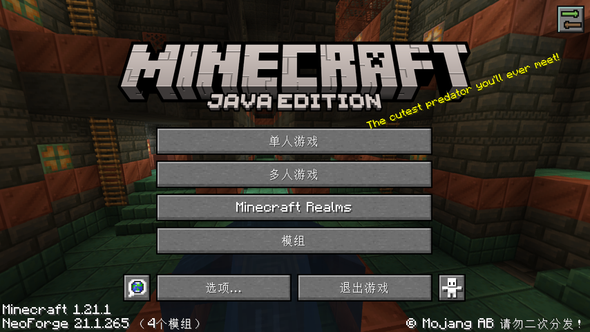

# GUI / mods 文件夹监听（计划）

> 状态：**Phase 1/2 初版 + i18n 已实现并验证（dev）**。目标：检测到 mods 文件夹新增 jar 时提示用户，确认后尝试热加；失败时给出可读原因和下一步建议。
> 前置：A1.2 主路径 + 失败回滚已跑通（`HotAddEngine` / `Rollback`）；本功能不改皇后级的“需要重启”边界；贵妃级自 2026-11-15 起可实验性加载（带警告，见 [t4-registry-hotadd.md](t4-registry-hotadd.md)）。

## 1. 目标与非目标

### 目标

1. 游戏运行时监听 `mods/`（以及可选的 `modreloader/inbox/`），发现稳定新增的 `.jar`。
2. 对候选 jar 做**预检**：mod 元数据、依赖、预测 tier、mixin/registry/native 信号。
3. 用非阻塞 toast + 可选的弹窗提示：“发现新模组 X，尝试加载？”。
4. 用户确认后调用现有 `HotAddEngine.add`；显示加载中 / 成功 / 失败。
5. 失败时按阶段给出原因、建议、回滚结果，支持复制报告、打开日志。
6. 默认**不自动加载**；皇后级只提示“需要重启”，贵妃级只做实验性 add-only 加载。

### 非目标

- 删除/卸载/更新已加载 mod（当前只有 add）。
- 自动信任任意路径的 jar；只监听配置的目录。
- 替代分析器；预检只做运行时可承受的轻量分类。
- 贵妃级软重启 / 皇后级 native 热替换。

## 2. 用户体验

### 2.1 检测到新 jar

主菜单/世界中显示 toast：

```text
发现新模组
Foo 1.2.3（预测妃级）   [加载] [稍后]
```

- 默认主菜单自动打开 `NewModsScreen`；世界中默认只 toast（避免突然暂停），可通过配置改为自动打开。
- 屏幕里每个候选显示：文件名、mod id/name/version、预测 tier、依赖状态、状态（可加载 / 需要重启 / 已加载 / 预检失败）。
- 按钮：`加载`、`稍后`、`忽略此文件`、`详情`。
- `加载` 对嫔/妃级（依赖满足）与贵妃级（实验性，带警告）可用；皇后级禁用。
- `加载` 的可用性与引擎 `VALIDATE` 使用同一组门禁（`ModInspection.canHotLoad`）：已加载、皇后级、缺必需依赖、access transformer（未开 `-Dmodreloader.lateAt=true`）都禁用。禁用时**按钮附近必须写出这一条原因**，不能只靠按钮变灰——2026-11-17 的 bug 就是 AT 分支漏在 `blockReason` 之外，Mekanism 显示“实验性热加”却点不动（见 status 已知问题 23）。
- 多候选时逐个加载，或按依赖顺序批量；第一版建议逐个，失败不影响其他候选。

### 2.2 加载中

- 禁用按钮，显示 `正在加载 Foo…`；`HotAddEngine.add` 在客户端线程执行（当前设计）。
- 资源包重载可能触发短暂 loading overlay；UI 等待完成后再显示结果。
- 同一时间只允许一个 add（single-flight）；其他候选排队。

### 2.3 成功

- toast `已加载 Foo`；关闭或刷新屏幕。
- 记录该 jar 的指纹，避免再次提示。
- 若资源包/翻译生效失败，作为 warning 显示，不把 add 判失败。

### 2.4 失败

显示 `LoadFailureScreen`：

```text
加载失败：Foo
阶段：MIXIN / CONSTRUCT / MODLIST / PACK ...
原因：缺少依赖：bar >= 1.2
建议：安装 bar，或把 Foo 放到 mods 后重启
回滚：ModList/module/mixin/类/资源包已恢复（2 个 warning）
[复制详情] [打开日志] [关闭]
```

- 失败原因来自结构化 `FailureKind`，不是直接抛异常字符串。
- 详情包含：jar 路径、mod 元数据、预测 tier、阶段、异常类/message、前 5 个栈帧、回滚报告、`latest.log` 路径。
- `复制详情` 写入剪贴板；`打开日志` 打开 `logs/latest.log` 所在目录。
- 失败后保留该 jar 的失败指纹，避免每次扫描都弹；用户可手动 `重试`。

### 2.5 忽略 / 稍后

- `稍后`：不再自动弹窗/toast；jar **仍留在「待处理」列表**里，随时可以回来处理
  （主动打开列表走 `scanPending()`，不按「已见过」指纹过滤）。
- `忽略此文件`：按 `路径 + size + mtime` 持久化到 `config/modreloader/watcher.json`；
  在「已忽略」视图里可以**恢复**，不会变成找不到的文件。
- 入口：主菜单 / 暂停菜单**右上角**的品牌 logo 按钮（20×20 像素图：绿色 → / 棕色 ← 交换箭头 + 石头槽位；鼠标悬停显示名称）。
  左下角有版本号与版权行，所以入口不放左下角。



## 3. 架构

新增包：

```text
dev.modreloader.ui/            # Screen / Toast / 文本渲染
dev.modreloader.watch/         # 文件夹监听、候选队列、指纹
dev.modreloader.diagnose/      # Java 预检 + 失败分类
dev.modreloader.config/        # 客户端配置
```

### 3.1 组件

| 组件 | 职责 |
|---|---|
| `ModsFolderWatcher` | 轮询目录、稳定检测、候选队列；后台线程；结果 `Minecraft.execute` 回主线程 |
| `CandidateJar` | 路径、指纹、首次发现时间、状态、预检结果 |
| `ModInspector` | 读 `neoforge.mods.toml`/`mods.toml`、mixin configs、class 引用；预测 tier/依赖/side |
| `FailureAnalyzer` | 把 `HotAddFailure` 映射为原因 + 建议 + 回滚摘要 |
| `NewModsScreen` | 候选列表、加载/稍后/忽略/详情 |
| `LoadFailureScreen` | 结构化失败、复制、打开日志 |
| `ModReloaderToasts` | 检测/成功/失败 toast |
| `ModWatcherConfig` | 开关、轮询间隔、是否在世界内自动弹、自动加载白名单 |

### 3.2 线程模型

- 扫描在 daemon `ScheduledExecutorService`（2s 轮询），不触碰游戏对象。
- 发现稳定候选后 `Minecraft.getInstance().execute(() -> ui.onCandidates(...))`。
- `HotAddEngine.add` 在对应端的主线程调用（客户端渲染线程 / 服务端 Server thread）；客户端 UI 单飞锁避免并发。
- 加载期间 watcher 继续扫描但只入队，不并发 add。

## 4. 检测策略

### 4.1 目录

- 主目录：`FMLPaths.MODSDIR`（即 `run/mods` / 正式 `mods`）。
- 可选测试目录：`run/modreloader/inbox`（避免测试时污染启动 mods，推荐测试用）。
- 监听集合可配置；默认两者都监听（inbox 可关闭）。

### 4.2 基线

- 启动完成后（`FMLLoadCompleteEvent` 或 client tick 后）记录当时所有 jar 的指纹；**不提示**基线内文件。
- 只对基线之后新增/变化的文件提示。
- 已加载的 mod id：仍提示“已加载；更新需要重启”，不尝试 add。
- 不在启动加载过程中扫描。

### 4.3 稳定检测

- 只接受 `.jar`，忽略 `.disabled`、`.part`、`.tmp`、隐藏文件、目录、0 字节。
- 指纹 = `size + mtime`，稳定两轮（默认 2 × 2s）后才进入候选；可选 sha256 用于忽略持久化/重复检测。
- 文件在候选队列中被替换/删除时取消候选并提示。
- 处理“多个 jar 同时拷入”：同一轮发现多个候选，按文件名/依赖排序后入队。

### 4.4 去重

- 已加载 `ModList.isLoaded(modId)` → 已加载状态。
- 同一路径指纹已在 `ignored` / `failed` / `loaded` → 不重复提示。
- 同一 mod id 多个 jar → 标记冲突，禁止加载，提示只保留一个。

## 5. 预检与 tier 预测

运行时不依赖 Python 分析器；用 Java + ASM 做轻量预检，结果只用于 UI 提示和是否允许尝试加载。

### 5.1 元数据

- 读 `META-INF/neoforge.mods.toml`（兼容 `mods.toml`）。
- 提取：mod id/name/version、`clientSideOnly`、依赖（required/optional）、`[[mixins]]`、access transformers、coremods。
- 检查 `required` 依赖是否在 `ModList`（或同批候选）中；缺失则直接“缺依赖”，不尝试 add。

### 5.2 Tier 信号

| 信号 | 预测 |
|---|---|
| 无 mixin、无 registry 调用、无 native | 嫔级 |
| mixin configs / `@Mixin` target | 妃级 |
| `DeferredRegister` / `RegisterEvent` / `BuiltInRegistries` | 贵妃级 |
| native lib / coremod / ASM transformer / 性能核心 | 皇后级 |

- 嫔/妃级：允许“加载”按钮。
- 贵妃级：显示实验性警告（存档依赖/不可回滚），加载可用（2026-11-15 起）。
- 皇后级：显示“需要完整重启”，禁用加载。
- 预检不确定时显示“未知”，默认只允许“详情”，不自动尝试。

### 5.3 与 A1.2 能力对齐

- A1.2 只验证了嫔/妃级的 add；贵妃/皇后级仍明确不支持。
- 预检不是安全证明；用户点“加载”后仍可能失败，失败分析负责解释。
- 若 JBR 未启用/非 JBR：妃级预检直接提示“需要 JBR 21 + `-XX:+AllowEnhancedClassRedefinition`”，不尝试。

## 6. 失败分析

### 6.1 结构化失败

把 `HotAddEngine.add` 的 `Result(boolean, String)` 升级为：

```java
record HotAddOutcome(
    boolean ok,
    Stage stage,          // READ, MODULE, MIXIN, MODLIST, CONSTRUCT, EVENT, PACK
    FailureKind kind,     // MISSING_DEPENDENCY, JBR_REQUIRED, MIXIN_CONFIG, ...
    String summary,
    String detail,
    Throwable cause,
    RollbackReport rollback
) {}
```

- 每个阶段包一层 `try/catch`，抛 `HotAddFailure(stage, kind, ...)`；顶层统一生成 outcome。
- 保留 `Result` 兼容命令/现有测试，或让 `Result` 内嵌 outcome。
- `RollbackReport` 包含每步成功/失败；失败分析必须显示“是否已回滚”。

### 6.2 原因分类与建议

| kind | 判定 | 建议 |
|---|---|---|
| `NOT_A_MOD` | 无 `neoforge.mods.toml`/`mods.toml` | 不是 NeoForge 模组；检查加载器/文件完整性 |
| `INVALID_METADATA` | TOML/依赖解析失败 | 重新下载；查看详情 |
| `MISSING_DEPENDENCY` | required 依赖不在 ModList/候选 | 安装依赖；或重启 |
| `ALREADY_LOADED` | `ModList.isLoaded` | 更新/重载未支持；需要重启 |
| `UNSUPPORTED_TIER` | 预检贵妃/皇后级 | 需要重启/软重启；不热加 |
| `JBR_REQUIRED` | 布局变更但非 JBR/未开 flag | 换 JBR 21 + flag，或等 sidecar |
| `MIXIN_CONFIG` | config 解析/注册/prepare 失败 | 检查 mixin config/版本；可能是妃级兼容问题 |
| `MIXIN_TARGET` | target 加载/织入/接口合并失败 | 提供 target/config；建议重启或反馈 |
| `REDEFINE` | JBR redefine 失败 | 布局/类不可修改；需要重启 |
| `MODLIST` | ModList/module 重建失败 | 依赖/模块冲突；重试或重启 |
| `CONSTRUCT` | `@Mod` 构造器抛异常 | 显示异常类/message；可能依赖缺失 |
| `EVENT` | 生命周期事件失败 | 显示事件/异常；监听器可能残留 |
| `RESOURCE_PACK` | 资源包注入/重载失败 | warning；可继续，重启后恢复 |
| `ROLLBACK_PARTIAL` | 回滚有 error | **建议重启**；展示残留项 |
| `UNKNOWN` | 兜底 | 完整报告 |

- 失败详情自动带：jar、mod id/version、预检 tier、是否 JBR、阶段、异常、回滚、日志路径。
- 对 `CONSTRUCT`/`EVENT`/`ROLLBACK_PARTIAL`，明确提示“监听器/部分状态可能残留，建议重启”。

## 7. 配置（建议）

客户端配置，默认保守：

```toml
[watch]
enabled = true
modsFolder = true
inbox = true
pollSeconds = 2
stableScans = 2

[ui]
openPromptInMainMenu = true
openPromptInWorld = false       # 世界中只 toast
toastOnDetect = true

[loading]
autoLoad = false                # 默认必须确认
allow嫔级 = true
allow妃级 = true
allow贵妃级 = false
allow皇后级 = false

[ignore]
# 路径 + size + mtime 的持久化列表；UI 可清空
```

- 配置放 `config/modreloader-client.toml`（NeoForge `ModConfigSpec`）或 JSON；忽略列表单独文件更易读写。
- 修改后无需重启；watcher/UI 读取最新值。
- 正式产品可加“只允许 mods 目录”的硬限制。

## 8. 安全与边界

1. **默认不自动加载**：任何 add 必须用户确认（除非显式开启 autoLoad + 白名单）。
2. **贵妃/皇后级不热加**：只提示需要重启；不要因为“有回滚”就尝试注册表内容。
3. **只监听配置目录**：不监听任意路径；UI 显示绝对路径。
4. **不加载已加载 mod**：更新/重载仍未支持，提示重启。
5. **单飞**：同一时间一个 add；失败后允许重试，但保留失败指纹避免循环弹窗。
6. **回滚结果必须展示**：失败时告诉用户是否恢复；有残留建议重启。
7. **不打断世界创建/加载**：检测到候选先入队，等屏幕稳定/主菜单再提示；世界中默认 toast。
8. **不自动信任 jar**：预检只做提示，不是安全扫描；用户自己放入的 mod 仍由用户确认。

## 9. 实施阶段

### Phase 1：基础（无 GUI）——**已实现**

- `HotAddOutcome` + 阶段化异常 + `RollbackReport` 暴露。
- `ModInspector`：元数据/依赖/mixin/tier 预检。
- `FailureAnalyzer`：分类 + 建议文本。
- `ModsFolderWatcher`：轮询、稳定检测、基线、去重（先只在日志/命令里输出）。
- `/modreloader scan` 显示候选/预检结果。
- 测试：坏 jar/缺依赖/贵妃/皇后级/正常妃级；现有 A1.2 回归。

### Phase 2：Toast + 简单列表——**已实现初版**

- `NewModsScreen`（列表 + 加载/稍后/忽略）。
- 检测 toast + `/modreloader gui` 手动打开。
- 成功/失败 toast。
- 测试：手动放入 jar、点击加载、成功/失败。

### Phase 3：完整弹窗与失败面板——**部分实现（i18n 已完成）**

- 主菜单自动打开；世界中可配置。
- `LoadFailureScreen`：结构化原因、建议、回滚、复制、打开日志。
- 忽略持久化、失败重试、加载中状态。
- i18n（en_us/zh_cn）、截图。

### Phase 4：硬化——**未做**

- 多候选/依赖排序、同 mod id 冲突、文件被替换/删除。
- `-PverifyGui` 自动测试（放置 jar → 等弹窗 → 点击加载 → 断言）。
- 贵妃/皇后级的“需要重启”流程。
- 文档/状态表尺更新。

## 10. 验证计划

| 用例 | 操作 | 预期 |
|---|---|---|
| 正常嫔/妃级 | inbox 放入 EasyLAN/LSP | 检测 → 弹窗 → 加载 → 成功 |
| 坏 jar | 放入非 mod jar | 预检失败/构造失败 → 失败面板，回滚 |
| 缺依赖 | jar 依赖不存在的 mod | 预检直接“缺依赖”，不尝试 |
| 贵妃级 | Ex Nihilo 或贵妃级 jar | 显示实验性警告（存档依赖/不可回滚），Load 可用（2026-11-15 起） |
| 皇后级 | native/性能 jar | 显示“需要完整重启” |
| 已加载 | 重复放入已加载 jar | “已加载；更新需要重启” |
| 部分文件 | 复制中/半截 jar | 不提示；稳定后才处理 |
| 删除/替换 | 候选期间文件删除 | 取消候选，不崩 |
| 世界中 | 世界中放入 jar（默认） | 只 toast，不自动弹 |
| 回滚 | 强制失败 | 失败面板显示回滚结果；有残留提示重启 |

自动化：`-PverifyGui`（dev-only）用 `run/modreloader/inbox` + 已下载测试 jar；不提交 jar。

## 11. 待确认

1. 监听范围：真实 `mods/`、独立 `inbox/`，还是两者？（建议两者，inbox 仅 dev 测试）
2. 世界中检测到时：只 toast，还是自动弹窗？（建议只 toast，主菜单自动弹）
3. 贵妃/皇后级：只提示“需要重启”，还是允许用户“仍然尝试”？（建议禁用；A1.2 明确不承诺）
4. 自动加载：是否永远不自动，还是提供显式白名单？（建议默认永不自动）
5. 忽略/失败记录存哪：客户端 TOML 还是独立 JSON？（建议独立 JSON，按路径+指纹）


## 12. 初版实测（2026-11-15）

### 已实现

- `run/mods` + `run/modreloader/inbox` 双目录轮询；2s、稳定 2 次；启动基线；忽略/失败指纹。
- `ModInspector`：FML `mods.toml` 元数据 + 依赖 + mixin configs + ASM registry/native 扫描；嫔–皇后级预测。
- `ModReloaderScreen`：候选列表、tier、预检原因、加载/稍后/忽略/关闭；贵妃/皇后级的加载按钮禁用。
- 主菜单自动弹出；世界中只 toast（代码路径）。
- `LoadController` 单飞；失败 `LoadFailureScreen`（原因/建议/回滚/复制/打开日志/重试）。
- `config/modreloader/watcher.json`：独立 JSON，含 ignored/failed；永不自动加载。
- `/modreloader scan`、`/modreloader gui` 已注册。
- **i18n**：`assets/modreloader/lang/en_us.json` + `zh_cn.json`（现各 134 key，键集与占位符由单测核对）；GUI/按钮/toast/命令/预检/失败摘要/复制详情的标签全部走翻译 key。
- dev 检查：`-PverifyWatch=true -PwatchJar=<jar>`；`-PwatchExpectFailure=true`。

### 实测

```bash
./gradlew runClient -PverifyWatch=true \
  -PwatchJar=/tmp/lanmods/EasyLAN-neoforge-1.21.1-v1.6a.jar
```

```text
[ModReloader] new mod candidate watchcheck-EasyLAN-neoforge-1.21.1-v1.6a.jar: easylan 1.5 · 嫔级
[WatchCheck] prompt opened ... (1 candidate(s))
[ModReloader] UI load succeeded: hot-added [easylan] (modules [easylan])
[WatchCheck] RESULT: PASS
```

坏 jar：

```bash
./gradlew runClient -PverifyWatch=true -PwatchExpectFailure=true \
  -PwatchJar=/tmp/watch-bad.jar
```

```text
[ModReloader] new mod candidate ...: ... · not a valid jar/zip (corrupt or incomplete)
[WatchCheck] failure screen opened; RESULT: PASS
```

贵妃级：

```bash
./gradlew runClient -PverifyWatch=true -PwatchExpectFailure=true \
  -PwatchJar=../Ex-Nihilo-Satellitium/build/libs/exnihilosatellitium-1.21.1-1.5.0.jar
```

```text
[ModReloader] new mod candidate ...: exnihilosatellitium 1.5.0 · 贵妃级 · registry
```

弹窗显示 `[贵妃级]`、加载按钮“不可加载”、原因“registry content: requires restart/soft restart”。

LSP + 强制 add 失败（验证失败屏 + 回滚集成）：

```bash
./gradlew runClient -PverifyWatch=true -PwatchExpectFailure=true \
  -PwatchJar=/tmp/lanmods/lanserverproperties-1.13.2-neoforge.jar \
  -PfailAfterModList=true
```

```text
[ModReloader] new mod candidate ...: lanserverproperties 1.13.2 · 妃级 · mixins
[ModReloader] rollback: deactivated mixin config lsp.mixins.json
[ModReloader] rollback: module layer ok
[WatchCheck] failure screen opened; RESULT: PASS
```

截图：[watch-prompt.png](images/watch-prompt.png)（EasyLAN，中文）、[watch-prompt-en.png](images/watch-prompt-en.png)（EasyLAN，英文）、[watch-prompt-t4.png](images/watch-prompt-t4.png)（贵妃级，不可加载）、[watch-failure.png](images/watch-failure.png)（坏 jar，翻译后的失败屏）。

### i18n 实测

- 中文：`run/options.txt` `lang:zh_cn` → `watch-prompt.png`；按钮/标题/toast 均为中文，无 key 泄漏。
- 英文：切到 `lang:en_us` 后同样通过；截图 [watch-prompt-en.png](images/watch-prompt-en.png)；测试后已恢复 `zh_cn`。
- 键覆盖：`ModReloaderToasts`、`ModReloaderScreen`、`LoadFailureScreen`、`ReloaderCommands`、`ModReloaderI18n`、`FailureAnalyzer` 的可见文本均使用 `modreloader.*` key；语言文件各 134 key（键集与占位符由 `LangKeysTest` 核对）。
- `FailureAnalyzer` 的 detail/剪贴板标签（jar/预检/依赖/阶段/分类/回滚/日志）也已 key 化；异常原始消息和枚举名保留英文，便于排查。
- 技术值（异常消息、stage/kind 枚举、路径）保留原始英文；标签已本地化。

### 初版限制

- 世界内 toast 路径已由 `-PverifyAddCommandWatchJar` 验证（只 toast、不弹窗）。
- `/modreloader gui` / `scan` 命令未自动验证。
- 贵妃级提示屏的“不可加载”旧证据已过时：现在贵妃级可加载（实验性，见 [t4-registry-hotadd.md](t4-registry-hotadd.md)）。
- 忽略/失败 JSON 的持久化未手工验证；失败后“重试”按钮未自动验证。
- 弹窗最多直接显示 7 个候选，没有滚动列表；失败屏只显示摘要/建议，完整详情走复制/日志。
- 皇后级只提示重启；贵妃级在 2026-11-15 后走实验性 add-only 热加（提示屏有警告，见 [t4-registry-hotadd.md](t4-registry-hotadd.md)）。
- 没有自动加载（按所有者决定）。
- 皇后级 native/coremod 检测未用真实皇后级 jar 校准。
