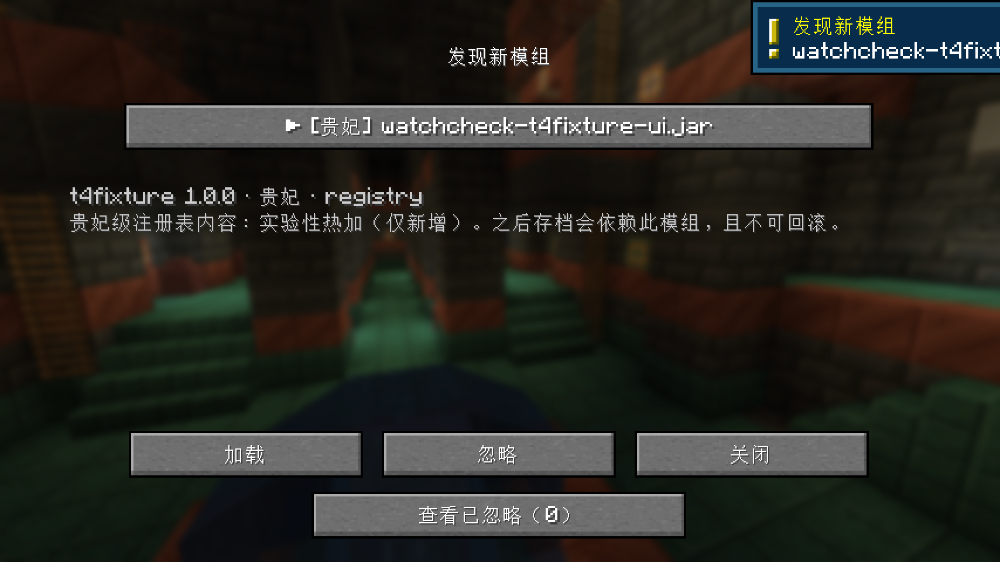

# 贵妃级注册表热加（实验性）

> 状态：**实验性能力**，已在 dedicated server 端到端验证，GUI 路径也已放行（2026-11-15）。
> 范围：built-in 注册表的 **add-only**（方块 / 物品）；不含删除、更新、datapack 内容。
> 背景与取舍见 [research-t4-registry.md](../research-t4-registry.md) 与 [ADR-0008](../decisions/0008-t4-registry-adaptation-poc.md)。

## 1. 机制

`hotadd/RegistryStage` 把一次贵妃级热加分三步（顺序与正常启动一致）：

```text
begin   → GameData.unfreezeData()        // 在构造之前：有的 mod 在构造器里直接 Registry.register
construct → @Mod 构造器 / DeferredRegister 挂监听
commit  → for registry in GameData.getRegistrationOrder():
              for container: container.acceptEvent(new RegisterEvent(key, registry))
          → 清空 Block.BLOCK_STATE_REGISTRY（NeoForge 的 BlockCallbacks 映射）
          → GameData.freezeData()        // 跑 bake：新方块 initCache/loot table、state id 从 0 重建、IdMappingEvent
```

两个关键点：

1. **`RegisterEvent` 按注册表、按容器重放**。全局重放会让每个已加载 mod 的注册监听器再跑一遍并撞
   `duplicate key`；`RegisterEvent` 的构造器是包私有的，用 trusted lookup 构造。
2. **freeze 前必须清空 BlockState id 映射**。`BlockCallbacks.onBake` 用 `IdMapper.add()` 重建，
   而 `add()` 无条件分配新 id；不清空的话 stone 的 id 会从 1 变成 26685（见 research §2），
   之后写出的区块会引用重启后不存在的 id。
3. **「清 id + freeze」必须跑在服务器线程**（2026-11-16，修已知问题 28）。这是整个 stage 里唯一「id 映射不完整」的窗口：
   `clear()` 之后到 bake 把 state 全部加回来之前，`IdMapper` 对任何 state 都给出 -1，而区块序列化在服务器线程上。
   调用方不在服务器线程时（dev harness、inbox watcher、GUI 都可能）用 `hotadd/ServerThreadHop` 投过去并等完成；
   已经在服务器线程（聊天里敲 `/modreloader add`、控制台）就直接跑。细节、证据与剩余边界见 §11。

失败语义是**单向提交**：注册表条目无法撤销。`begin` 时注册的 undo 只在 commit 之前有效
（清空 state map 后重新 freeze，id 回到 canonical）；commit 之后失败只记录
"registry content was committed and cannot be rolled back"，运行时视为 dirty。

## 2. 证据（2026-11-15 21:48，dedicated server）

夹具：[experiments/t4-fixture](../../experiments/t4-fixture/)（一个方块 + 一个 BlockItem，DeferredRegister）。

第一次运行（热加 + 放置 + 存盘）：

```text
[ModReloader] registry content detected: true
[ModReloader] registry window open: blocks=1060 items=1333 states=26684 stoneId=1
[T4Fixture] constructed
[ModReloader] registry commit: 89 registries replayed; blocks 1060 -> 1061, items 1333 -> 1334,
              states 26684 -> 26685 (cleared 26684 entries), stoneId 1 -> 1 (stable)
[T4Fixture] common setup: block=t4fixture:test_block entryId=1060 stateId=26684 item=t4fixture:test_block itemId=1333
[ModReloader] hot-added [t4fixture] (modules [t4fixture])
[T4Fixture] placed t4fixture:test_block at BlockPos{x=0, y=100, z=0}; readback=true stateId=26684
[T4Fixture] world saved; RESULT: PLACED
```

第二次运行（fixture 放进 `run/mods`，正常启动，读档）：

```text
[T4Fixture] common setup: block=t4fixture:test_block entryId=1060 stateId=26684 item=t4fixture:test_block itemId=1333
[T4Fixture] restart readback BlockPos{x=0, y=100, z=0}: expected=t4fixture:test_block
            actual=t4fixture:test_block isT4Block=true RESULT: PASS
```

结论：add-only 的方块/物品在服务端可以热加，id 稳定，放置后存盘、重启读档仍然正确。

## 3. 客户端路径（2026-11-15 22:21，单人/集成服务器）

fixture 现在带 blockstate / model / lang，并监听 `BuildCreativeModeTabContentsEvent`。
在**世界里**执行 `/modreloader add`：

```text
registry commit: ... stoneId 1 -> 1 (stable)
[T4Fixture] added item to creative tab minecraft:building_blocks
[ModReloader] rebuilt 14 creative tab(s) after registry content
[T4Fixture] common setup: entryId=1060 stateId=26684 item=t4fixture:test_block itemId=1333
[ModReloader] resource packs selected after add: [... mod/t4fixture] (new [mod/t4fixture])
[AddCmdCheck] RESULT: PASS
```

`PlatformHooks.afterRegistryContent()` 在 commit 之后重建创造栏（`CreativeModeTabRegistry.sortTabs()` +
对每个 tab `buildContents(params)`），所以已经在世界里时也能看到新物品。资源包仍走 A1.2 的注入路径。

## 4. GUI 路径（2026-11-15 22:18）

watcher 把 fixture 丢进 inbox 后，提示屏显示 `[贵妃]` 与警告文案（实验性 / 仅新增 / 存档依赖 / 不可回滚），
Load 可用；点击后走同一个引擎，`WatchCheck RESULT: PASS`。截图：



```bash
./gradlew runClient -PverifyWatch=true -PwatchJar=/tmp/t4fixture-ui.jar -PwatchModId=t4fixture
```

## 5. 真实模组演练（无中生有：众星捧月 1.5.0，2026-11-15 23:14）

真实 dogfood 模组 `exnihilosatellitium-1.21.1-1.5.0.jar`（80 方块 / 181 物品 / 自定义机器数据，无 mixin）：

```text
[ModReloader] registry content detected: true
[ModReloader] registry window open: blocks=1060 items=1333 states=26684 stoneId=1
[ModReloader] registry commit: 89 registries replayed; blocks 1060 -> 1140, items 1333 -> 1514,
              states 26684 -> 26818 (cleared 26684 entries), stoneId 1 -> 1 (stable)
[ModReloader] adapted payloads for exnihilosatellitium: [exnihilosatellitium:set_machine_output]
[ModReloader] rebuilt 15 creative tab(s) after registry content
[ModReloader] resource packs selected after add: [... mod/exnihilosatellitium] (new [mod/exnihilosatellitium])
[AddCmdCheck] ModList exnihilosatellitium: isLoaded=true, container=true
[AddCmdCheck] RESULT: PASS
```

标题屏 `-PautoAdd` 与进世界 `/modreloader add` 都通过。

**但这不等于「能玩」**：它的 299 个配方、77 个战利品表、标签和自定义机器数据都是 **datapack 内容**，
热加后不会进入当前数据包列表——方块能放，但合成/掉落/挖掘等级可能不对；放置/破坏/合成也没有实测。
完整生效仍需把 jar 放进 `mods/` 重启。存档一旦使用这些内容，就绑定该 mod。

> **2026-11-15 后续**：datapack 部分已由 [t4-datapack-hotadd.md](t4-datapack-hotadd.md) 补齐——同一次热加
> 现在还会注入 data pack 并走 `reloadResources`，实测 recipes 0→164、loot 0→75、真实合成与战利品掉落 PASS。
> 本节的「需重启」结论只描述当时的状态。

## 6. 复现

```bash
# 1) 构建夹具（需要先 ./gradlew build 生成 build/moddev/*LegacyClasspath.txt）
./experiments/t4-fixture/build.sh

# 2) 热加 + 放置 + 存盘 + 退出
./gradlew runServer -PautoAdd=/tmp/t4fixture/t4fixture-1.0.0.jar -Pt4fixtureSelftest=true

# 3) 把夹具放进 run/mods（模拟"下次正常启动"），读档验证
cp /tmp/t4fixture/t4fixture-1.0.0.jar run/mods/
./gradlew runServer -Pt4fixtureSelftest=true -Pt4fixtureSelftestRead=true
rm run/mods/t4fixture-1.0.0.jar
```

## 7. 限制（按当前实现）

- **多端**：客户端资源包、创造栏重建已在单人/集成服务器验证；专用服 + 独立客户端的 id 同步见 §9（已跨进程验证）。
- **add-only**：没有删除/更新；删掉 mod 会让存档里的条目变成 missing entries（NeoForge 提示并丢弃）。
- **不支持 datapack 内容** → **已补齐**：recipe / loot / tag / mod 自注册的 server reload listener 现在随热加载重载
  （见 [t4-datapack-hotadd.md](t4-datapack-hotadd.md)）；**世界生成注册表**（biome / dimension / structure）
  仍要重启或新世界，附魔/伤害类型/纹饰等 RELOADABLE 层会跟随 `/reload`。
- **不支持 mod 自建注册表**：`NewRegistryEvent` 在启动后关闭（`pendingModdedRegistries = null`）。
- **post-register 事件未重放**：`BlockEntityTypeAddBlocksEvent` / spawn placements / attribute modifications
  还没有接；方块 + 物品之外的实体类内容暂时不要指望。
- **UI 已放行，但只有警告、没有确认框**：Load 一次点击即提交，且不可回滚。
- **real mod 的 datapack 内容仍是空白** → **已补齐**（同上）：众星捧月热加后配方/战利品/标签/机器数据都会加载（§5 的后续注）。
- **多人登录同步** → **已补上「连接后」这一半**（2026-11-16，见 §9）：两端都要热加同一批 jar，服务端把权威 id 映射用我们自己的 play 通道推给在线客户端；
  两端条目集合不一致时客户端**拒绝应用**（不是部分应用），并提示把 jar 也装到客户端。**没有客户端那半（客户端不装 jar）仍然不行**——
  registry 的「值」是客户端本地注册的对象，快照只重排 id，不会凭空造出方块。
- **提交后失败不可回滚**：运行时被标记 dirty，只能重启。

## 8. 下一步

1. **datapack 热加载**：已完成，见 [t4-datapack-hotadd.md](t4-datapack-hotadd.md)。
2. ~~多人：连接后热加~~ 已实现（§9）：play 通道 + `RegistryManager.applySnapshot`，跨进程 harness `-PverifyMpRegistry` 实测 PASS。
   剩下的：客户端不装 jar 的场景（需要先解决资源/类的分发），以及「连接后**双方**热加的顺序」之外的复杂情况（部分 mod 只在一边）。
3. 失败语义：construct 抛异常时确认 abort 能恢复 canonical id，并把 dirty 状态暴露给用户。

## 9. 多人：连接后热加的 id 同步（2026-11-16）

### 9.1 问题

NeoForge 只在登录的 **configuration 阶段**同步注册表（`SyncRegistries` + `FrozenRegistryPayload` + `RegistryManager.applySnapshot`）。
单人可以，因为集成服务器和客户端共用 `BuiltInRegistries`；**专用服 + 独立客户端**不行：
服务端热加后，已在线客户端仍然用它自己算出来的 block/item id，区块段、物品栈、实体生成全部指错条目。
而「两端都在连接前热加」也只是碰巧——两边的 id 顺序未必一样。

### 9.2 做法

play 阶段没有对应的 payload，所以本运行时自己开了一条通道（两端都跑 runtime，这和一直接受的 payload 适配前提一致）：

```text
服务端 commit 之后：
  RegistryManager.takeSnapshot(SYNC_TO_CLIENT)
    → 每个注册表一个 RegistrySyncPayload(registry, snapshot, last=最后一个)
    → 发给所有已连接玩家（PlatformHooks.registrySyncTargets()）
客户端收到：
  累积整批 → 校验「两端条目集合完全一致」→ RegistryManager.applySnapshot(batch, false)
    → 不一致：不发住应用，提示把 jar 也装到客户端（状态不变）
    → applySnapshot 返回 missing：revertToFrozen() 回到登录快照 + 提示
    → 成功：afterRegistryContent() 重建创造栏 + 聊天提示
```

另外还有反向的一半：**客户端热加后主动请求**（`RegistrySyncRequestPayload`，playToServer），服务端回它的当前映射——
否则「客户端先加、服务端后加」的时序里客户端会一直用本地 id。决策与备选见 [ADR-0010](../decisions/0010-post-connect-registry-sync.md)。

三个不显然的点：

1. **`applySnapshot(map, false)` 就是登录期那段代码**，不是我们重写的：它 `unfreeze → clear(false) → registerIdMapping → freeze`，
   `freeze` 触发 NeoForge 的 bake callback，**block state id 随之按新顺序重建**（`BlockCallbacks.onBake`）。这条依赖从 NeoForge 源码确认过。
2. **必须整批、且两端集合一致**。`applySnapshot` 不会删客户端的多余条目：只重排 id。若快照是客户端集合的**子集**，
   客户端多出来的条目会变成「没有 id」（`getId` = -1），区块/物品栈同样错位——所以客户端在应用前先比较 key 集合，不一致就完全不应用。
3. **不踢人**。登录期不一致会断开连接（NeoForge 的做法），但游戏中间踢人比保持旧状态更糟：客户端拒绝 + 提示，
   下次登录时 NeoForge 会自然带上新的注册表（热加之后进来的客户端不需要任何额外步骤）。

### 9.3 证据（2026-11-16 10:40，dedicated server + 独立客户端，跨进程）

`dev/MpRegistryCheck`（客户端）+ `dev/MpRegistryServerCheck`（服务端），通过 `run/` 下的 marker 文件协调：

```bash
# 服务端：等客户端 ready 后按「先众星捧月、后 t4fixture」热加
./gradlew runServer -PmpRegistryServer=/abs/exnihilosatellitium-1.5.0.jar,/tmp/t4fixture/t4fixture-1.0.0.jar
# 客户端：进世界后按「先 t4fixture、后众星捧月」热加（故意不同顺序 → id 必然不同）
./gradlew runClient -PverifyMpRegistry=/tmp/t4fixture/t4fixture-1.0.0.jar,/abs/exnihilosatellitium-1.5.0.jar
```

```text
[MpRegistry] client hot-add t4fixture: ok=true
[MpRegistry] client hot-add exnihilosatellitium: ok=true
[MpRegistry] client registries after its own adds: blocks=1141 items=1515
[ModReloader] refusing the server registry snapshot: ... client has 182 entries the server does not ...
[ModReloader] applied registry snapshot from the server: 30 registries, 5043 entries
[MpRegistry] ids match the server exactly (29475 lines, blocks=1141, items=1515)
[MpRegistry] RESULT: PASS
```

服务端侧：`registry snapshot: 30 registries -> 1 connected player(s)`（两次 push：众星捧月后、t4fixture 后），
`answered a registry sync request from Dev with 30 registries`（客户端两次请求），datapack 仍正常应用（recipes 0→164）。

断言是**全量**的：29475 行 = 每个方块 id + 每个物品 id + 每个 block state id，全部与服务端一致——
包括 block state id，说明 `applySnapshot` 之后 bake 重建的映射与服务端相同。

### 9.4 边界

- **客户端必须也有同一批模组**（同一批 jar，各自热加或启动时就装好都可以）。不一致时客户端拒绝应用并提示；
  没有「客户端只拿 id、不装 jar」这种模式——registry 的值是客户端本地注册的对象，快照只重排 id。
- 这是**运行时自有通道**，所以两端都必须装 NoRestart；热加的那个 mod 不需要知道。
- 只覆盖 `doesSync = true` 的 built-in 注册表（和登录同步同一个集合）。
- 专用服上的 **mixin（妃级）热加需要 JBR**：`runServer` 目前不带 `-XX:+AllowEnhancedClassRedefinition`，
  实测 ZeroCore2 在专用服上 redefine `Slot` 会失败（客户端同样的操作成功）。与 id 同步无关，但会让「服务端热加一个有 mixin 的内容 mod」失败。
- **两端 runtime 版本不一致没有验证过**：通道由 `registrar("1")` 声明，旧端收到不认识的 payload 预期会被 NeoForge 断开；
  没有握手、没有降级，也没有版本不匹配的测试。

## 10. 客户端没有这个 mod 时会怎样（2026-11-16 实测）

热加一个**双端**内容模组时，服务端在线玩家的处境（`dev/MpNoticeServerCheck` + `dev/MpNoticeClientCheck`，
2026-11-16 11:48，专用服 + 一个**故意没有该 jar** 的客户端）：

```text
[11:48:28] [client] server hot-added t4fixture 1.0.0 (jar t4fixture-1.0.0.jar, sha256:a7168198…,
                    tier guifei, registry content true); this client does NOT have it
[11:48:28] [client] [CHAT] 服务端正在热加 T4 Registry Fixture 1.0.0（jar t4fixture-1.0.0.jar，sha256 a7168198…）。
                    你没有这个模组：你很快会被断开，并且在把同一个 jar 放进 mods/ 并重启之前无法重新进入。
[11:48:28] [client] still connected=true                       ← 通知先到
[11:48:28] [client] DecoderException: Failed to decode packet 'clientbound/minecraft:update_recipes'
                                                                ← datapack 同步把连接打死
[11:48:28] [server] told 1 connected player(s) about [t4fixture]: T4 Registry Fixture 1.0.0 (jar …, sha256:…)
[11:48:28] [server] WARN 1 player(s) connected: registry content cannot be undone. A client without this
                    mod will be disconnected by the data pack sync and cannot rejoin until it installs…
[11:48:28] [server] Dev has [] of the hot-added mod id(s) this runtime noticed; anything missing must
                    be added on their client too                              ← 客户端回报的 ack
```

三条结论：

1. **`update_recipes` 会踢人，不需要 mod 自己发包**：配方引用了客户端不认识的物品，解码直接失败。
   所以「没有注册表内容的 mod 才安全」不成立——**带 datapack 的 mod 一样会踢**。
2. **之后连不回来**：登录同步的快照含客户端不认识的条目 → NeoForge `server-with-unknown-keys` 再断一次。
   这和「服务器启动时就装了该 mod」完全一致，只是热加把它变成了一件**在线时发生**的事。
3. 通知必须**在 commit / datapack 重载之前**发。反例实测过：放在管线末尾时，notice 到达的是一条已经死掉的连接。

**能同步的只有 id 映射**（§9），且前提是客户端本地已有这些条目；jar（类）、资源、payload channel 都推不过去。
所以文案里只承诺「装上同一个 jar 之后就能回来」，不承诺「会自动装好」。

安全网（已实现）：notice（不分 tier 都发）→ 客户端聊天 + toast（有/没有该 mod 两种文案）→ 客户端 ack → 服务端日志
`<player> has [...] of the hot-added mod id(s)`；服务端在有玩家在线 + 注册表内容时，commit 前再打一条 WARN。
决策与未决项见 [ADR-0011](../decisions/0011-hotadd-must-inform-clients.md)。

## 11. id 重建与区块发送的竞态（2026-11-16，已修）

### 11.1 症状

进世界后热加众星捧月时，客户端收到一个 chunk 包报 `IllegalArgumentException: No value with id -1`
（`LinearPalette.read`），随后服务端以「网络协议错误」断开玩家（[status](../status.md) 已知问题 28）。
只复现过一次（2026-11-16 18:50，capability 重放那一轮），之后同路径两次正常。

### 11.2 为什么

`commit` 原来在**调用线程**上做「清 `BLOCKSTATE_TO_ID_MAP` → `GameData.freezeData()`」。
那张表就是 `Block.BLOCK_STATE_REGISTRY`（NeoForge 的 `ClearableObjectIntIdentityMap`，区块 palette 读写的就是它），
而 `clear()` 到 bake 把 state 全部加回来之间是唯一「表不完整」的窗口：`IdMapper.getId` 对任何 state 都返回 -1。
区块序列化在**服务器线程**上；dev harness 是从客户端 tick 里直接 `dispatcher.execute("modreloader add …")`，
也就是 **render 线程**。两个线程一撞，服务器就把 -1 写进 palette，客户端解码必失败
（聊天里敲同一条命令不会：那条路径本来就在服务器线程上）。

### 11.3 修法

新增 `hotadd/ServerThreadHop`：

- 取 `ServerLifecycleHooks.getCurrentServer()`；**没有服务器**（标题屏 / 专用服还没起来）或
  **`server.isSameThread()`** 时直跑；
- 否则 `server.execute(...)` 投过去并等完成（日志 `registry freeze: hopping from the thread '…' to the server thread`）；
- 超时（服务器在停 / 不 tick）回退到调用线程并 WARN；队列里那份用原子 claim 保证**不会执行两次**。

`abort()`（失败回滚）里的「清 id + freeze」走同一条路——它有完全相同的窗口。
`RegisterEvent` 重放仍留在调用线程（本次设计如此；注册本身不碰 id 表）。

### 11.4 证据（2026-11-16 19:27–19:28，dev client，众星捧月 1.5.0）

```text
[19:27:07] [Render thread/INFO] [ModReloader] registry freeze: hopping from the thread 'Render thread' to the server thread
[19:27:07] [Render thread/INFO] [ModReloader] registry commit: 89 registries replayed; blocks 1060 -> 1140,
           items 1333 -> 1514, states 26684 -> 26818 (cleared 26684 entries), stoneId 1 -> 1 (stable)
...
[GameplayCheck] capability providers: [barrel.item=present, barrel.fluid=present, crucible.fluid=present,
                machine.item=present, machine.energy=present]
[GameplayCheck] RESULT: PASS
```

`-PverifyAddCommand=<dogfood> -PverifyAddCommandModId=exnihilosatellitium -PverifyGameplay=true` **连跑 3 次**
（19:27:07 / 19:27:53 / 19:28:32）：3/3 都出现 hop 日志、3/3 `AddCmdCheck RESULT: PASS` + `GameplayCheck RESULT: PASS`、
capability 五项 present、每次 `registry commit … stoneId 1 -> 1 (stable)`、
三次日志里 **0 处** `No value with id`（也没有 `RESULT: FAIL` / 断线）。

改动后另跑两条回归：

- **专用服 guifei 路径**（`runServer -PautoAdd=/tmp/t4fixture/t4fixture-1.0.0.jar -Pt4fixtureSelftest=true`）：
  commit 打在 `[Server thread]` 上、**没有** hop 日志（`isSameThread()` 分支生效），
  `blocks 1060 -> 1061 … stoneId 1 -> 1 (stable)`、`world saved; RESULT: PLACED`、`datapack (after hot-add) RESULT: PASS`。
- **嫔级路径**（`-PverifyAddCommand=/tmp/lanmods/EasyLAN-neoforge-1.21.1-v1.6a.jar`）：`AddCmdCheck RESULT: PASS`；
  这条不打开注册表窗口，本来就不经过 hop。

### 11.5 剩余边界

- 挪走的只是「清 id + freeze」。单人游戏里客户端与服务器**共享同一张表**：如果 add 走聊天命令（服务器线程），
  render 线程在那一瞬间仍可能解码一个**已经编码好**的包，读到清空窗口。修复后三次实测都没有问题，
  但这是**把窗口从编码端挪走 + 缩小**，不是把它变成「不可能」。彻底做法是让 bake 不重建整张表（append-only），
  或在重建期间暂停区块编解码；两者都还没做，也没有稳定复现手段。
- harness / watcher / GUI 这条路径上 render 线程自己就在 hop 里阻塞，解码不会与窗口重叠，所以这条路径的风险实际被消除了。
- 同一套线程假设没有单测覆盖（要真服务器）；回归靠 `-PverifyAddCommand -PverifyGameplay`。

## 12. 数据包注册表（`DataPackRegistryEvent.NewRegistry`，问题 66，2026-11-21）

内置/自定义注册表（`NewRegistryEvent`）之外，还有一种**按世界加载**的注册表：`DataPackRegistryEvent.NewRegistry`
把 codec 交给 NeoForge 的 `DataPackRegistriesHooks`，世界加载时由 `WorldLoader` → `RegistryDataLoader`
从 `data/<任意命名空间>/<注册表命名空间>/<路径>/` 读 JSON 建表；带网络 codec 的还会同步给客户端。

热加原先不发这个事件，Create 的 `create:potato_projectile/type`（马铃薯炮弹药类型）在客户端 level
`RegistryAccess` 里不存在：打开机械动力创造栏渲染马铃薯炮时
`IllegalStateException: Registry create:potato_projectile/type not found`。

修法（`hotadd/DatapackRegistries`）：

- construct 之后，对新容器逐个 `OneShotReplay.fire` 同一个 `NewRegistry` 事件，再调包私有 `process()`；
- 重复 key 拒绝：`addRegistryCodec` 无去重，重复条目会让 registry loader 出错；遇到已存在的 key 视为重试并跳过；
- 加入 `inspect/ReplayCatalog`（审计与被审计的是同一张表）。

时序：`WorldLoader` 用的是 `getDataPackRegistries()` 的**活视图**，网络同步列表 `SYNCHRONIZED_REGISTRIES`
也是活视图，所以**标题屏热加对下一个世界/连接生效**；已打开的世界持有冻结的 `RegistryAccess`，
新注册表只对下次加载可见（日志会说明，需要重启）。

证据（dev client + 增强 JBR，`-PverifyCreatePonder=<create>`）：热加 Create → 建世界 →
`create:potato_projectile/type entries=25`、`PotatoCannonItem.getAmmo()` 不再抛（返回 null，装饰器判空跳过）、
`PonderRenderTypes` 正常 → `RESULT: PASS`。

## 13. 服务端先热加、客户端重启加载后加入（late join，2026-11-22 PASS）

`dev/MpLateJoinServerCheck` + `dev/MpLateJoinClientCheck`。与 §9 的区别：服务端**没有在线玩家时**先热加，
客户端随后把同一 jar 放进 `run/mods` 启动并加入（不是连接后再热加）。

流程：

1. 服务端启动，harness 在 `ServerStartedEvent` 后约 1s 热加 jar；写
   `run/mp-latejoin-server.txt`（全量 id dump）与 `run/mp-latejoin-ready.txt`。
2. 看到 ready 后，把同一 jar 放进 `run/mods`，启动客户端；客户端启动时正常加载该 jar。
3. 客户端加入后等 8s 让登录同步完成，比较 29,080 行 id。
4. **L2 动作**：服务端把玩家传送到 (0.5, 121, 0.5) 的测试平台并给 `t4fixture:test_block`；
   客户端对 (1, 120, 0) 的顶面执行 `useItemOn`，把方块放到 (1, 121, 0)；
   服务端确认权威 block state，客户端确认本地 block state。
5. 再保持 10s；服务端在放置成功后 20s 自动停。

```bash
# 终端 1：服务端先热加（无玩家）
./gradlew runServer -PmpLateJoinServer="/tmp/t4fixture/t4fixture-1.0.0.jar|t4fixture"

# 等 run/mp-latejoin-ready.txt 出现后，终端 2：
cp /tmp/t4fixture/t4fixture-1.0.0.jar run/mods/
./gradlew runClient -PverifyMpLateJoin="/tmp/t4fixture/t4fixture-1.0.0.jar|t4fixture" -PnoFocus=true
# 跑完删除 run/mods 里的夹具
```

证据（2026-11-22 09:59–10:01，专用服 + 独立客户端；L2 版本）：

- 服务端：`no players online; hot-adding ... isLoaded=true`；`blocks 1060 -> 1061, items 1333 -> 1334`；
  `no players online; the next join gets the mod through the normal login path`（`ModNotice` 没有在线目标）。
- 客户端：`joined; isLoaded=true, noticeCount=0`（late join 不收到在线通知）；
  `ids match the server exactly (29080 lines, blocks=1061, items=1334)`；
  `prepared to place t4fixture:test_block at BlockPos{x=1, y=121, z=0}`；
  `useItemOn(BlockPos{x=1, y=120, z=0}, up) = SUCCESS`；
  `client placed t4fixture:test_block ... (local block state confirmed)`；
  `still connected=true, playerAlive=true ... after 10s`；`RESULT: PASS`。
- 服务端：`placed the player at (0.5, 121.0, 0.5) and gave t4fixture:test_block`；
  `client placed t4fixture:test_block at BlockPos{x=1, y=121, z=0} (server block state confirmed)`；
  `RESULT: PASS`；放置成功后 20s `stopping the server`，`runServer` 以 0 退出。

结论：

- 服务端热加时**没有在线玩家** → 不会发 `server_mod_notice`；late joiner 只要本地有同一个 jar，
  NeoForge 登录同步会带上注册表，无需额外步骤（验证了 §9 的推断）。
- **L2 不只是 id/连接**：客户端真实放置热加方块，服务端与客户端都确认了 `(1,121,0)` 的 block state
  （测试平台/传送/创造模式仅用于 harness）。
- **没装 jar 的 late joiner 仍会在登录期被 `server-with-unknown-keys` 拒绝**，且收到不到友好通知
  （§10 的 notice 只覆盖在线客户端）。这是已知 UX 缺口，本次 harness 未覆盖。
- 客户端后来放进 `run/mods` 的同一 jar 会被 watcher 按“已加载 modId”跳过，不会重复热加。

## 14. 客户端热加后的 L2 放置（2026-11-22 PASS）

复用 §9 的 `MpRegistryServerCheck` / `MpRegistryCheck`，加一个可选的 `-PmpRegistryPlace="<modId>|<blockPath>"`：
双方初始都没有该 jar；客户端连接后**先热加**，服务端等客户端 ready 后**再热加**并推快照；
id 对齐后，服务端准备平台并给方块，客户端执行真实 `useItemOn`，服务端确认权威 block state。

```bash
# 终端 1：服务端初始没有 t4fixture
./gradlew runServer -PmpRegistryServer=/tmp/t4fixture/t4fixture-1.0.0.jar \
  -PmpRegistryPlace="t4fixture|test_block"

# 终端 2：客户端也初始没有 t4fixture，连接后热加并放置
./gradlew runClient -PverifyMpRegistry=/tmp/t4fixture/t4fixture-1.0.0.jar \
  -PmpRegistryPlace="t4fixture|test_block" -PnoFocus=true
```

证据（2026-11-22 10:06–10:07，专用服 + 独立客户端）：

- 客户端：`client hot-add t4fixture: ok=true`（blocks=1061/items=1334）；写 ready；
  `ids match the server exactly (29080 lines)`；`useItemOn(...) = SUCCESS`；
  `client hot-add placed t4fixture:test_block ... (local block state confirmed)`；
  `still connected=true ... after 10s`；`RESULT: PASS`。
- 服务端：客户端 ready 后 `server hot-add t4fixture: ok=true`；写 29,080 行 dump；
  `placed the player ... and gave t4fixture:test_block`；
  `client placed t4fixture:test_block ... (server block state confirmed)`；`RESULT: PASS`；
  20s 后自动停，`runServer` exit 0。

与 §13 的区别：

- §13 是客户端**重启加载**（jar 在 `run/mods`），服务端先热加；
- §14 是客户端**连接后热加**，服务端后热加；两边都初始没有该 jar，走运行时快照同步后再放置。
- 默认 `-PverifyMpRegistry`（不带 `mpRegistryPlace`）行为不变，仍是纯 id 同步。

### 14.1 真实内容模组：众星捧月 1.5.0（2026-11-22 PASS）

同一命令换成 dogfood jar 与真实方块：

```bash
JAR=/Users/kaifengcrt/Projects/Ex-Nihilo-Satellitium/build/libs/exnihilosatellitium-1.21.1-1.5.0.jar
./gradlew runServer -PmpRegistryServer="$JAR" \
  -PmpRegistryPlace="exnihilosatellitium|iron_ore_gravel"
./gradlew runClient -PverifyMpRegistry="$JAR" \
  -PmpRegistryPlace="exnihilosatellitium|iron_ore_gravel" -PnoFocus=true
```

证据（专用服 + 独立客户端，双方初始都没有该 jar）：

- 客户端：`client hot-add exnihilosatellitium: ok=true`（blocks=1140/items=1514）；
  `ids match the server exactly (29472 lines)`；
  `useItemOn(...) = SUCCESS`；
  `client hot-add placed exnihilosatellitium:iron_ore_gravel ... (local block state confirmed)`；
  `still connected=true ... after 10s`；`RESULT: PASS`。
- 服务端：`server hot-add exnihilosatellitium: ok=true`；写 29,472 行 dump；
  `client placed exnihilosatellitium:iron_ore_gravel ... (server block state confirmed)`；
  `RESULT: PASS`；20s 后自动停，`runServer` exit 0。

说明：这是真实内容模组（80 方块/181 物品 + datapack），不是 `t4fixture`；
客户端走的是**连接后热加**路径，服务端后热加并推快照，然后客户端放置真实方块。

### 14.2 真实 JBR 模组：AE2 + GuideME（2026-11-22 PASS）

AE2 是 J1（需要 JBR/late AT）的真实内容模组，依赖 GuideME；两者都走客户端连接后热加：

```bash
JARS=/tmp/modreloader-corpus/guideme-21.1.22.jar,/tmp/modreloader-corpus/appliedenergistics2-19.2.20.jar
./gradlew runServer -PmpRegistryServer="$JARS" \
  -PmpRegistryPlace="ae2|quartz_block"
./gradlew runClient -PverifyMpRegistry="$JARS" \
  -PmpRegistryPlace="ae2|quartz_block" -PnoFocus=true
```

证据（2026-11-22 10:25–10:27）：

- 客户端：`client hot-add guideme: ok=true`、`client hot-add ae2: ok=true`
  （redefined 12 个客户端/服务端类，blocks=1162/items=1698）；
  `ids match the server exactly (34809 lines, blocks=1162, items=1698)`；
  `useItemOn(...) = SUCCESS`；
  `client hot-add placed ae2:quartz_block ... (local block state confirmed)`；
  `still connected=true ... after 10s`；`RESULT: PASS`。
- 服务端：`server hot-add guideme/ae2: ok=true`；写 34,809 行 dump；
  `client placed ae2:quartz_block ... (server block state confirmed)`；`RESULT: PASS`；
  20s 后自动停，`runServer` exit 0。

结论：真实 JBR 档（AE2 + GuideME）在“客户端连接后热加 → 服务端后热加 → 快照对齐 →
客户端真实放置”路径上 PASS。

### 14.3 Create 6.0.10：J2 边界（未通过放置）

同一命令把 AE2 换成 Create（`-PmpRegistryPlace="create|andesite_casing"`）：
客户端 `client hot-add create: ok=true`（blocks=1703/items=2032，含 JiJ flywheel/ponder），
但随后 tick 崩溃：

```text
java.lang.IllegalStateException: Cannot get config value before config is loaded.
  at net.neoforged.neoforge.common.ModConfigSpec$ConfigValue.get
  at net.createmod.catnip.config.ConfigBase$CValue.get
  at net.minecraft.world.entity.player.Player.modifyExpressionValue$zzm000$create$pretendNotPassenger
  ...
```

这是 Create 的已知 J2 配置问题（Ponder 配置在客户端 tick 读取时尚未加载），
不是 late-join/L2 harness 的问题；客户端未写 ready，服务端未进入放置，测试按失败收尾。
